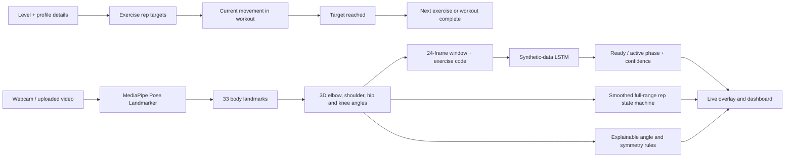

# LSTM Posture Coach — v6 coach-calculated rep targets

A separate v6 local Streamlit prototype where users choose one or more of six exercises and the coach calculates a target for each from workout level, height, and weight. Earlier ZIPs remain unchanged.

## Prototype disclosure

The included LSTM is trained on generated synthetic movement sequences because no labeled human dataset is bundled. The synthetic model demonstrates a temporal inference pipeline; it is **not validated on real people**, and its confidence is not a real-world accuracy score. Live coaching cues are generated by transparent joint-angle rules. This project is for an academic demonstration, not medical or injury-prevention advice.

## Features

- A workout builder that lets the user select any subset of exercises, including just one
- Coach-calculated, exercise-specific rep targets from workout level and the height/weight-derived BMI input
- Height and weight profile fields used in the target calculation
- Live webcam input with an annotated pose overlay (`streamlit-webrtc`), selected-exercise auto-advance, idle encouragement, and completion for only the chosen workout
- Uploaded video analysis
- MediaPipe 3D world landmarks, eight LSTM features, smoothed angle display, strict full-range repetition counting, and exercise-specific feedback
- Six exercises: push-up, squat, bicep curl, front raise, high knees, and lateral raise
- Automatic clearer-side tracking for push-ups, bicep curls, and front raises

## Setup

Python 3.15 is supported by the updated dependency set. On Apple Silicon, use a recent macOS release so the PyTorch wheel is available. From this project directory:

```bash
python3.15 -m venv .venv
source .venv/bin/activate        # Windows: .venv\Scripts\activate
python -m pip install --upgrade pip
pip install -r requirements.txt
python scripts/download_pose_model.py
streamlit run app.py
```

The pose model is a small MediaPipe Lite model bundle and is downloaded to `models/`; the model file is excluded from Git. Webcam workout and uploaded-video analysis both need it. If a previous version has already downloaded the model, copy `models/pose_landmarker_lite.task` into this version's `models/` folder.

On the first launch, the app trains the small LSTM on generated sequences. Training data is created in memory and is not a human dataset. The model is cached for the current Streamlit process.

## Demo walkthrough

1. Choose a workout level, enter height and weight, and select one or more exercises.
2. Select **Calculate targets and create workout**. The coach shows a level baseline and its calculated target for each selected exercise.
3. Select **Start workout** and allow browser camera access. The app shows the current target, live reps, angle, feedback, and camera-position guidance.
4. Finish each selected target to advance automatically. The app completes as soon as the selected list is done; it does not require every available exercise.
5. If movement pauses for eight seconds while a pose remains visible, the app shows an encouragement message. Use **Analyze a video** to inspect a clip separately.

To do only one exercise, select just that exercise; the coach calculates its target and completes that workout when the target is reached.

## Project structure

```text
app.py                         Streamlit workout coach and video-analysis flows
posture_coach/engine.py        Pose extraction, synthetic data, LSTM, coaching logic
scripts/download_pose_model.py One-time MediaPipe model download
requirements.txt               Python dependencies
```

## Algorithm outline

1. MediaPipe estimates 33 pose landmarks for each frame.
2. The app computes elbow, shoulder, hip, and knee angles from MediaPipe's 3D world landmarks, then normalizes them to `[0, 1]` for the LSTM.
3. A 24-frame window plus a selected-exercise one-hot code feeds an LSTM, which predicts ready/active movement phase.
4. A smoothed, exercise-specific state machine requires a clear start position, a held active range, and a full return before counting. High knees count each leg after a completed lift and return.
5. Rule-based angle and alignment checks generate concise feedback. When the required landmark confidence is low, the app asks the user to reposition and does not advance the counter. The coach advances through only the selected movements after each calculated target is reached.



## Limitations and next steps

- Generated sequences do not establish accuracy on real camera input. Do not report synthetic training performance as real-world performance.
- Joint angles vary with camera viewpoint, body proportions, occlusion, and pose-estimator error. Thresholds are demonstration defaults.
- Rep personalization is an explicit demo heuristic: workout level supplies exercise-specific baseline reps; BMI = weight (kg) / height (m)² then adjusts the target by −1 rep for BMI below 18.5 or from 25 to under 30, −2 reps for BMI 30 or above, and no adjustment from 18.5 to under 25. The final target has a floor of 5 reps. This formula is not a validated exercise prescription; BMI is a screening measure and does not distinguish muscle, fat, or bone mass. [CDC BMI limitations](https://www.cdc.gov/bmi/about/)
- Use a side-on view for push-ups, bicep curls, and front raises; use a front view for squats, high knees, and lateral raises. The app chooses the more visible body side for side-view exercises.
- The coach follows the exercises selected in the workout and does not automatically identify an unknown exercise.
- A research evaluation should collect consented, labeled recordings across participants and viewpoints, split data by participant, tune thresholds on training/validation data, and report held-out results.

## Submission report checklist

Use the course template to include: team member name, roll number, email, and contact; problem statement; identified gaps; architecture diagram; algorithmic steps; dataset and tools; result screenshots; analysis against existing approaches; code link; novel contribution; individual contributions; learning outcomes; and AI tool usage. State that the initial LSTM data is synthetic. Fill team details and the eventual GitHub repository URL before submission.

## AI tool usage disclosure

Suggested disclosure (edit to match your actual use): “OpenAI Codex was used to assist with project planning, code drafting, documentation, and debugging. The team reviewed and adapted the generated work. The LSTM bootstrap sequences are synthetic and generated by the project code; they are not sourced from people or a public exercise dataset.”
